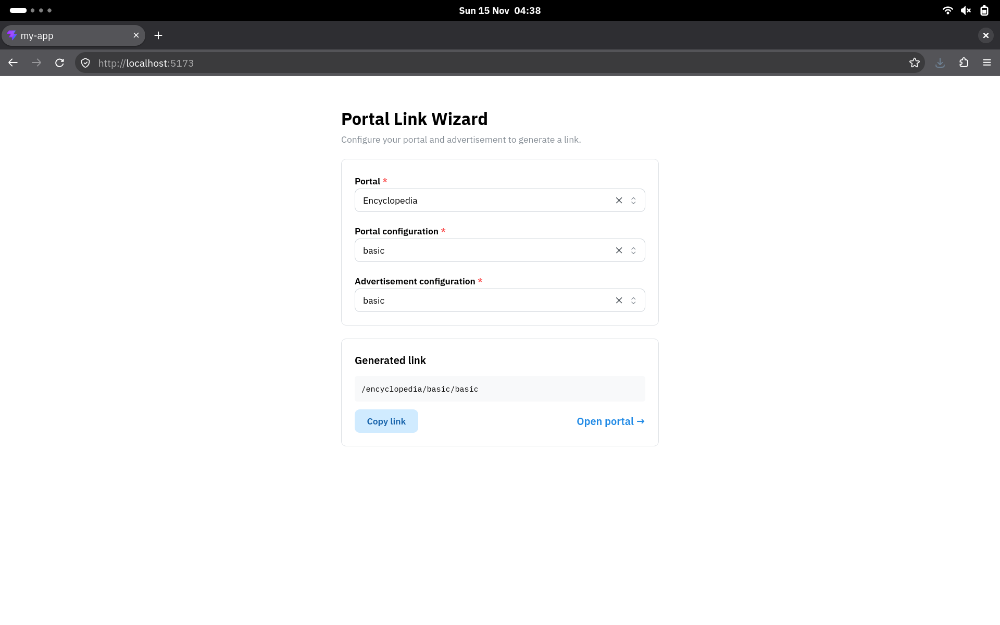
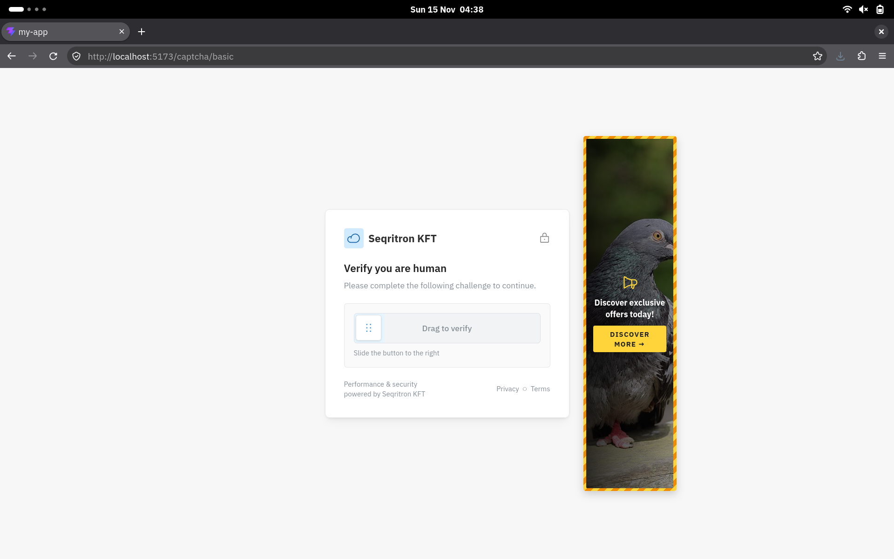
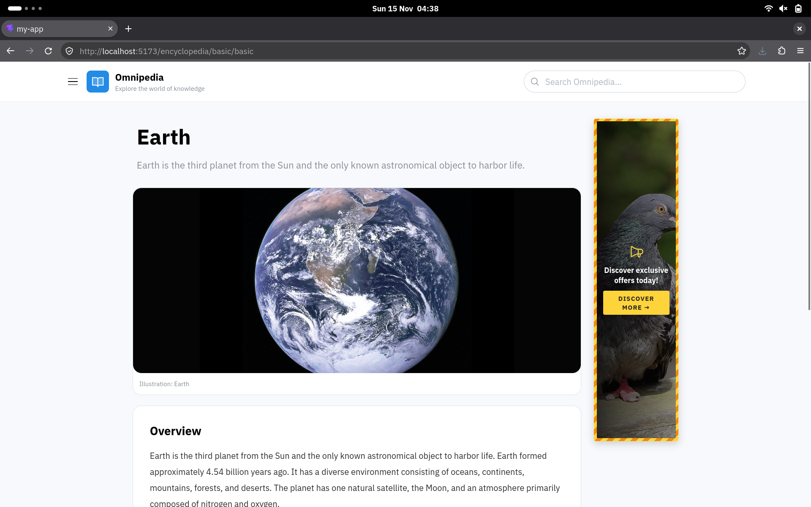
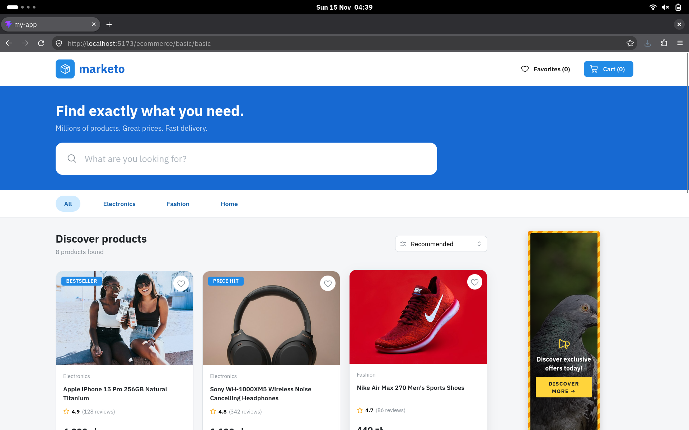
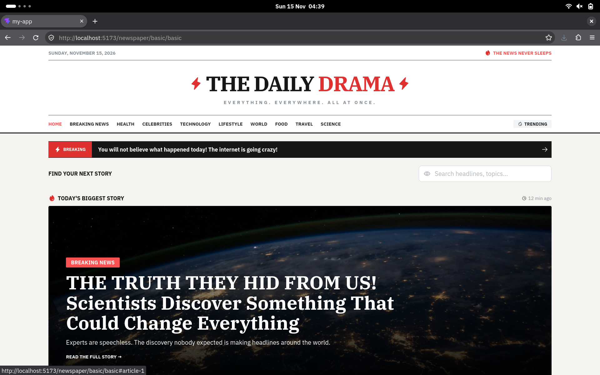
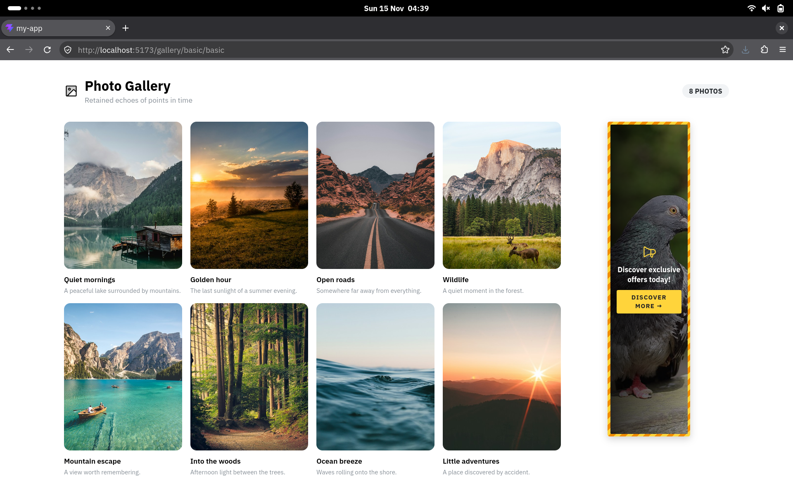
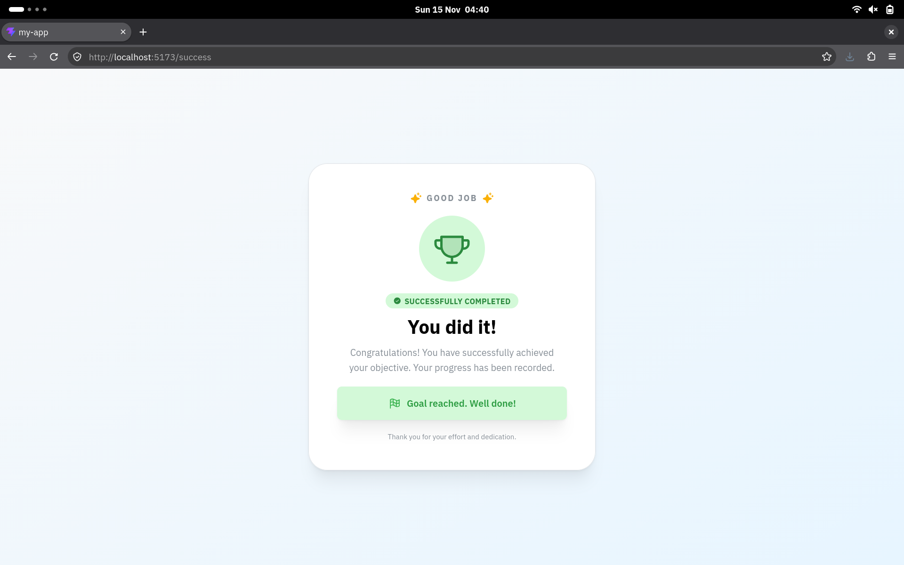

# TODO

- [x] components for basic websites
  - [x] captcha
  - [x] encyclopedia
  - [x] ecommerce
  - [x] newspaper
  - [x] gallery
- [x] make all basic components have only parametric content
- [x] make all basic components have directive
- [x] improve the components
- [x] add banners to basic components
  - [x] top, sidebar, other
  - [x] ad-like, similar styling to website
  - [x] content
  - [x] background
- [x] use react router to wire the application together
- [x] link builder
- [x] finalization page
- [ ] create content variety

---

[Video](./demo/demo.mp4)










---

# To add new ad configuration

1. Make a new .json file in `public/ad-config`, it would be reachable by its name
It should match
```ts
export type AdBannerLocation =
  | "top"
  | "sidebar"
  | "other";

export type AdBannerStyle =
  | "attention-grabbing"
  | "nondescript";

export interface AdBannerConfigSerialized {
  location: AdBannerLocation;
  style: AdBannerStyle;
  content: string;
  backgroundUrl?: string;
  icon?: string;
}
```

2. Add the file name without extension to array in `const adConfigIds: string[]` in `/src/LinkWizard.tsx`

---

# To add new portal configuration

1. Add new file in `public/portal-config` subfolder:
  - captcha
  - encyclopedia
  - ecommerce
  - newspaper
  - gallery
According to specification and examples from `/src/PortalTypes.ts`

2. Add the file name without extension to appropriate array of subkey in `const portalConfigIds: Record<PortalType, string[]>` in `/src/LinkWizard.tsx`

---

# Badanie Banner Blindness

Banner Blindness - fenomen z dziedziny UX, obejmujący sytuacje, gdy użytkownicy ignorują informacje zbliżone do bannerów, czasem świadomie, czasem nieświadomie.

Symulowana w eksperymencie byłaby sytuacja użytkownika, który wchodzi stronę internetową aby wykonać swoje zadanie.
Co może go skłonić do obejrzenia, a co do zignorowania bannerów?

Jakie cechy powodują pomijanie bannerów?
- położenie (top, sidebar, niestandardowe)
- styl (jasny reklamowy, podobny do strony, ze zdjęciami osób)
- powiązanie (powiązany z zadaniem, niepowiązany z zadaniem)

Użytkownicy mieliby wykonać zadania na spreparowanych stronach internetowych z bannerami

Przykłady zadań:
- wypełnienie captchy (jak cloudflare)
- znalezienie informacji w tekście (jak encyklopedia)
- zakup produktu (jak ecommerce)
- znalezienie artykułu (jak gazeta)
- znalezienie zdjęcia w galerii z kaflami (jak aplikacja galeria)
Dostęp tylko do myszy bez klawiatury aby nie tracić wzroku jeśli ktoś nie pisze bezwzrokowo

Do sprawdzenia:
- liczba fiksacji na bannerach o poszczególnych cechach
- pytania dotyczące zawartości bannerów
- czas do pierwszej fiksacji na bannerze

Kilka zadań na osobę, łącznie ~15 minut na osobę
Liczba badanych dowolna

Z wykorzystaniem okulografu stacjonarnego TobiiPro

Kwestionariusz nie jest konieczny poza zgodami na nagrywanie.
Można ewentualnie zapytać użytkowników o to co według nich powodowałoby pomijanie bannerów, i sprawdzić czy jest to zgodne z rzeczywistymi efektami.
